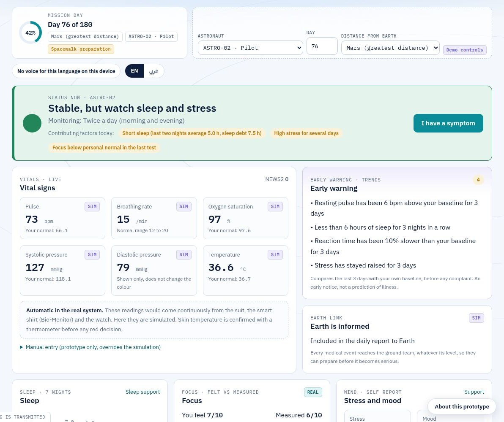

# AURA-5 — The fifth crew member

**NOVARAIA-X · NASA Space Apps 2026 prototype**

Challenge: **Create Health Monitoring Software for Astronauts on Space Missions**

AURA-5 is a bilingual astronaut-health support prototype combining synthetic vital signs, personal baselines, symptom checklists, sleep and psychological-support prompts, and a browser attention task. It helps demonstrate structured observations and follow-up while communication with Earth is delayed.

**Not a medical device, diagnosis system, or emergency service. Do not enter real personal or health information. No NASA approval or endorsement is claimed.**



## Links

- Live application: https://aegis-mind.replit.app/aura5/
- Official challenge: https://www.spaceappschallenge.org/2026/challenges/health-monitoring-software/
- Project demo: the team must upload its presentation PDF to a publicly accessible host and add the resulting link here. No hosted demo link has been supplied.
- Repository: this folder is prepared for upload; no GitHub repository has been created or published as part of this package.

The live app is an existing hosted build and may differ from this standalone packaging copy.

## The problem

Isolation, disrupted sleep, workload, and delayed communication make health observation and follow-up important on space missions. Mars messages may take approximately 4–24 minutes each way. AURA-5 explores a readable, crew-facing workflow, without claiming to solve autonomous space medicine.

## What works in this prototype

- Overview of six displayed vital measurements, synthetic records and manual entries.
- Four synthetic crew members across 180 mission days; personal baselines from the first 14 days.
- Morning and evening check-ins, sleep/stress support and trend flags.
- Schematic body selection, symptom questions and explained rule-based urgency categories.
- Re-measurement workflows and first-aid information.
- A browser reaction-time task inspired by PVT-B research; not a validated PVT-B implementation.
- Crew-readiness and task-swap suggestions, plus a tomorrow plan.
- Silent Hour: simulated communication delay, action logging and text-summary export.
- English and Arabic interfaces; browser-dependent speech recognition and synthesis.

## Try a demonstration

1. Open the overview and select a synthetic crew member and mission day.
2. Inspect the source labels and baseline comparison.
3. Complete a morning or evening check-in using fictional values only.
4. Select **I have a symptom**, choose a body region and answer the danger-sign questions.
5. Review the explained urgency result and follow-up options.
6. Open Silent Hour to simulate a delay and export a summary.

Labels matter: **SIM** means synthetic measurements; **MANUAL** means entered by a user; **REAL** refers to an actually played browser attention session, not an astronaut sensor feed.

## Run locally

Requires **Python 3.11+**.

```sh
python -m pip install -r requirements.txt
python src/main.py
```

Open `http://localhost:5000`. The application creates `src/data/aegis.db` automatically using the included synthetic CSV. The `PORT` setting is supported by the inherited entry point.

```sh
python tests/test_engines.py
```

The app uses Flask's development server and a per-process random session key in this package. Sessions reset after restart. This is suitable for a local synthetic demonstration, **not production deployment**.

## Repository layout

```text
README.md
requirements.txt
docs/          Overview, architecture, methodology, sources and limitations
src/           Flask entry point, storage, engines, templates, static assets
src/data/      Synthetic CSV, generator, rules and reference knowledge
data/          Dataset description and sharing policy
models/        Explanation of why no trained model weights are supplied
screenshots/   Real cropped dashboard screenshot
tests/         Inherited engine checks
UPLOAD_CHECKLIST.md
THIRD_PARTY_NOTICES.md
```

## Technology and AI methodology

Python, Flask/Jinja, SQLite, HTML/CSS and vanilla JavaScript. Decisions come from explicit rules and baseline comparisons—not a trained neural model or an LLM clinician. There are no model weights or model-accuracy claims. See [methodology](docs/AI_METHODOLOGY.md).

Replit Agent assisted the submission text, presentation copy and repository packaging. Prior AI involvement in the inherited application, logo or other assets has not been confirmed; the team must complete that disclosure before submission. Do not claim AI originated or did not originate the idea without checking the team's actual process.

## NASA resources and data

NASA publications inform communication latency, sleep/workload risk and isolation-support design. **No real astronaut health dataset is imported.** The measurements are synthetic. CSA Bio-Monitor is a future wearable reference, not a connected device.

See [NASA and research sources](docs/NASA_DATA_SOURCES.md), [dataset notes](data/README.md), and [third-party notices](THIRD_PARTY_NOTICES.md).

## Important limitations

- No connected wearable, automatic SOS dispatch, nearby-crew notification or real mission-control communication.
- Some inherited UI messages say notices were sent; those messages describe a **simulation only**.
- Custom thresholds and medical content require qualified review. NEWS2-derived bands do not mean complete NEWS2 compliance.
- Hosted SQLite storage is on the server, not exclusively on the visitor's device. No production access control, isolation or privacy assurance is claimed.
- Speech services and externally loaded fonts can need a network connection. Full offline operation is not guaranteed.
- Safety wording in the original project is an intention, not proof that all clinical edge cases behave safely.

See [testing and limitations](docs/TESTING_AND_LIMITATIONS.md).

## Team

**NOVARAIA-X**

| Member | Role |
| --- | --- |
| Jana mowafag mohmmad bni abdalhamed | Team leader |
| Jenan Fuad Sarhan | Team member |
| um kalthom abd alsalam | Team member |
| Shaimaa abbas rababa | Team member |

No individual technical responsibilities are assigned here without team confirmation.

## License and reuse

No open-source license has been selected or granted by this package. A public repository is not automatically open source. The team must verify ownership and choose its license before granting reuse rights. Inherited logos, knowledge text and other assets still need provenance review. See [notices](THIRD_PARTY_NOTICES.md).
